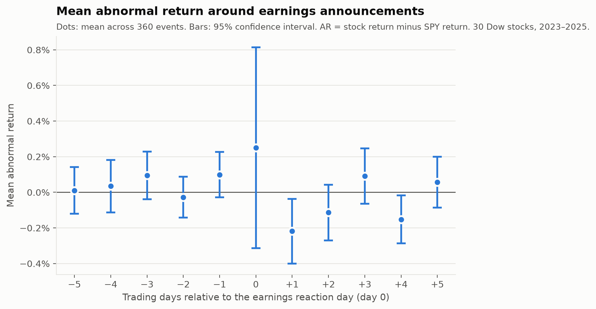
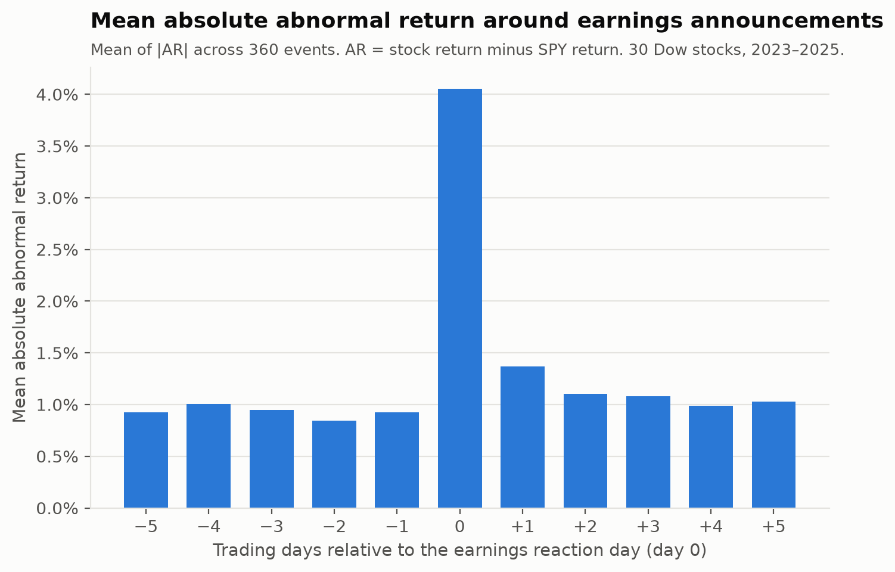
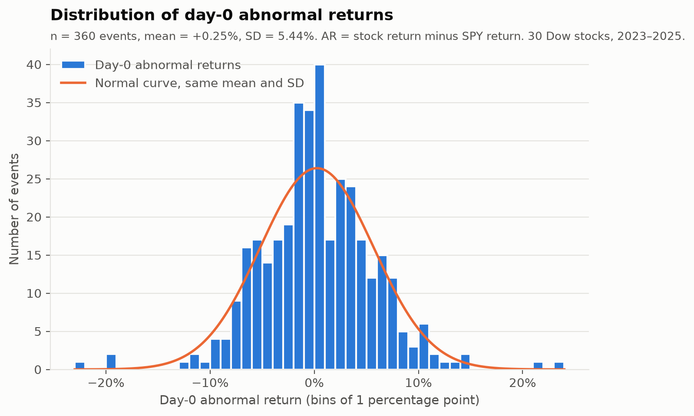

# earnings-event-study

An event study of how the 30 current Dow Jones Industrial Average stocks react to their quarterly earnings announcements from 2023 to 2025. The data pipeline downloads prices and earnings dates, builds event windows and abnormal returns in SQL (DuckDB), and tests them with standard one-sample t-tests.

**Research questions**

1. Is the mean abnormal return on the earnings reaction day different from zero? Is it different from zero when summed over the windows [−1, +1] and [−5, +5] trading days?
2. Do stocks move more, in absolute terms, on the earnings reaction day than on the quiet days before the announcement?

## Method

- **Data.** Daily adjusted close prices for the 30 current Dow stocks and SPY (the market benchmark), plus earnings announcement dates with their timing: before market open (BMO) or after market close (AMC). Both come from Yahoo Finance via `yfinance` and cover 2023-01-01 to 2025-12-31. That gives 360 events, 12 per stock.
- **Event day (day 0).** Day 0 is the first trading day on which the market can react. For a BMO release it is the announcement date. For an AMC release it is the next trading day. If the announcement date is not a trading day, day 0 is the next trading day.
- **Abnormal return.** AR = stock return − SPY return on the same day (the market-adjusted model). Each event has an 11-day window of trading days −5 to +5. The cumulative abnormal return (CAR) is the sum of the daily ARs over a window.
- **Tests.** Each test is a two-sided one-sample t-test of H0: mean = 0 across the 360 events, with t = mean / (sd / √n) and df = 359. The tests cover:
  1. Day-0 AR
  2. CAR[−1, +1]
  3. CAR[−5, +5]
  4. A per-event difference: |AR| on day 0 minus the mean |AR| over days −5 to −2 of the same event. This is equivalent to a paired t-test.

## Results

From [`results/summary.csv`](results/summary.csv) (n = 360 events for each test):

| Test | n | Mean | Median | SD | Share > 0 | t | p-value |
|---|---:|---:|---:|---:|---:|---:|---:|
| Day-0 AR | 360 | +0.25% | +0.10% | 5.44% | 51.1% | 0.87 | 0.384 |
| CAR[−1, +1] | 360 | +0.13% | +0.01% | 5.84% | 50.6% | 0.43 | 0.671 |
| CAR[−5, +5] | 360 | +0.13% | −0.30% | 7.04% | 48.6% | 0.34 | 0.735 |
| \|AR\| day 0 − mean \|AR\| days −5..−2 | 360 | +3.13% | +2.39% | 3.61% | 83.1% | 16.43 | 1.3 × 10⁻⁴⁵ |


*Mean abnormal return across 360 events for each trading day from −5 to +5, with 95% confidence interval bars.*


*Mean absolute abnormal return across 360 events for each trading day from −5 to +5.*


*Distribution of the 360 day-0 abnormal returns in 1-percentage-point bins, with a normal curve of the same mean and SD.*

## Findings

This project found that stock prices move much more on earnings days than
on quiet days, after subtracting market-wide moves, while the mean abnormal
return stays close to zero.

Abnormal return is defined as the stock's return minus SPY's return on the
same day. We tracked the 30 current members of the Dow Jones Industrial
Average across 360 earnings announcements from 2023 to 2025 and estimated
their abnormal returns around each earnings release.

On day 0 (the first trading day that can react to the release), the mean
abnormal return was +0.25% (p = 0.38, 95% confidence interval about −0.31%
to +0.81%), so it is not distinguishable from zero.

When we widen the window around day 0, the mean stays near zero and the
standard deviation increases. Among the 11 days examined, day +1 showed a
lower mean return (−0.22%) with a 95% confidence interval excluding zero.
This was not predicted in advance and does not survive a
multiple-comparison correction.

When we compare the absolute abnormal return on day 0 with the quiet days
before it, earnings days move more than four times as much on average
(about 4.05% against 0.93%). In 83% of events day 0 was larger than the
quiet-day average, and the paired t-test gave t = 16.4. The data show that
prices move more when new information arrives.

## Limitations

- **Data quality:** Prices and earnings dates come from Yahoo Finance, an
  unofficial source, via the yfinance library. We checked 9 of the 360
  events by hand (4 suspect records and 5 random ones) and corrected 2.
- **Independence:** The tests treat the 360 earnings events as independent.
  In practice most companies report within the same few weeks each quarter,
  often on the same day, and share sector news and market mood, so the
  p-values are somewhat too optimistic.
- **Market adjustment:** Subtracting SPY assumes every stock normally moves
  one-for-one with the market. In reality Nvidia tends to move more than
  the market and Coca-Cola less, so our "abnormal" return is a rough
  approximation.
- **Selection:** The sample is today's Dow members, which causes
  survivorship bias. It leaves out companies that were removed from the
  index after performing poorly, so the results may look more positive
  than they were for the actual members at the time.
- **Outliers:** The mean is sensitive to a handful of events; for example,
  NVDA had a +23.50% abnormal return on 2023-05-25. The median is below the
  mean in all three windows tested. Together with extreme moves in both
  directions, this indicates heavy tails with a slight right skew.

## How to run

You need Python 3.11 or newer (tested with 3.13) and an internet connection. Run these commands from a terminal on macOS or Linux:

```bash
# 1. Clone the repository
git clone https://github.com/Padisarah789/earnings-event-study.git
cd earnings-event-study

# 2. Create a virtual environment and install the packages
python3 -m venv .venv
source .venv/bin/activate
pip install -r requirements.txt

# 3. Download prices and earnings dates from Yahoo Finance -> data/raw/
python src/download.py

# 4. Load into DuckDB and apply data/corrections.csv -> data/earnings.duckdb
python src/load.py

# 5. Build daily returns, event days, abnormal returns and CARs (sql/*.sql)
python src/build_events.py

# 6. Check data quality (optional, prints only)
python src/quality_report.py

# 7. Run the t-tests -> results/summary.csv
python src/analyze.py

# 8. Draw the charts -> figures/*.png
python src/charts.py

# 9. Print example windows for hand-checking (optional)
python src/spot_check.py
```

Step 3 downloads fresh data, so your numbers can differ slightly from the committed results. Yahoo revises its data over time, and adjusted prices are rescaled after each new dividend. If Yahoo changes one of the corrected records, step 4 stops and reports which correction no longer matches.

## Repository structure

```
earnings-event-study/
├── README.md
├── PLAN.md                    task list and project log
├── requirements.txt           pinned Python packages
├── data/
│   ├── corrections.csv        manual fixes to earnings timing (committed)
│   └── raw/                   downloaded CSVs (not committed)
├── sql/
│   ├── 01_daily_returns.sql   daily returns + per-ticker trading-day index
│   ├── 02_event_days.sql      day 0 for each event (BMO/AMC rule)
│   ├── 03_abnormal_returns.sql  AR for days −5..+5 of each event
│   └── 04_car.sql             CAR[−1,+1] and CAR[−5,+5] per event
├── src/
│   ├── config.py              tickers, dates, paths
│   ├── download.py            fetch prices and earnings dates (yfinance)
│   ├── load.py                CSVs -> DuckDB, applies corrections.csv
│   ├── build_events.py        runs sql/*.sql in order
│   ├── quality_report.py      data and event-window checks
│   ├── spot_check.py          prints example windows for hand-checking
│   ├── analyze.py             t-tests -> results/summary.csv
│   └── charts.py              charts -> figures/
├── results/summary.csv        test results
├── figures/                   the three charts
└── notebooks/                 (empty, for exploration)
```

## Data sources and corrections

- **Prices and earnings dates:** [Yahoo Finance](https://finance.yahoo.com) via the [`yfinance`](https://github.com/ranaroussi/yfinance) package. This is an unofficial, scraped source with no guarantee of accuracy. The raw data and the DuckDB database are not committed. Anyone can rebuild them with steps 3 and 4 above.
- **Universe:** The 30 Dow members as of November 2026, which includes Alphabet (GOOGL). Alphabet replaced Verizon on 2026-06-29 ([S&P Dow Jones Indices announcement](https://press.spglobal.com/2026-06-23-Alphabet-Set-to-Join-and-Honeywell-International-to-Remain-in-Dow-Jones-Industrial-Average)).
- **`data/corrections.csv`:** Manual fixes to the Yahoo earnings data, each with its source and a note. The raw CSVs are never edited. `src/load.py` applies each correction after loading, and it stops with an error if a correction no longer matches the raw data. Rows where `old_value` equals `new_value` record a manual check that found no change was needed. The file currently corrects two timings (AMZN 2024-08-01 and AXP 2024-04-19, both from midday to AMC/BMO) and records four verified records (AMGN 2023-10-31, CVX 2023-07-23, DIS 2024-02-07, DIS 2024-05-07).
